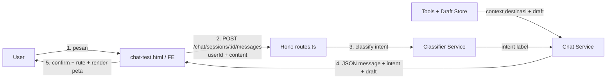

# Lahlah

Monorepo pnpm dan Turborepo untuk tiga aplikasi:

## Architecture — Lahlah Chatbot

### End-to-end flow (BPMN-style)



### Backend

- Runtime: Node.js 24 + Hono + Prisma 7 + PostgreSQL
- Entry: `apps/api/src/index.ts` → `apps/api/src/routes.ts`
- Key services:
  - `classifier.ts` → klasifikasi intent
  - `chat.service.ts` + `conversation-context.ts` → orkestrasi pesan + riwayat
  - `tools.ts` + `destinations` → `search_destinations`, `get_destination_details` (filter Padang)
  - `itinerary-generator.ts` + `draft-store.ts` → jadwal + draft memori TTL
  - `itinerary.service.ts` → confirm idempoten 201/200
  - `routing/` → proxy OSRM + cache LRU + fallback garis lurus
- Middleware: `requestId`, `logger`, `secureHeaders`, `bodyLimit`, `errorHandler`, `productionGate` (chat mati di production sampai auth ada)

### Frontend

- Stack: Vite + React + TypeScript + MapLibre GL JS (client uji statis dulu)
- Entry: `apps/app/public/chat-test.html`
- Components:
  - `tabs/sessions` → session persisten `localStorage`
  - `chat panel` → pesan user + assistant + metadata intent/draftId
  - `itinerary panel + map` → draft aktif, marker bernomor, garis OSRM teal / fallback orange
- Service: `fetch` langsung ke `/api/v1` (`request()`, `sendMessage()`, `confirmDraft()`, `loadRoute()`), cache rute di `sessionStorage`

Detail lengkap (sequence, flowchart routing, ER): [`docs/chatbot-architecture.md`](docs/chatbot-architecture.md), panduan pakai API: [`docs/chat-api-untuk-fe.md`](docs/chat-api-untuk-fe.md).

## Workspace

| Workspace | Stack | Port dev | Tujuan |
| --- | --- | --- | --- |
| `apps/app` | Vite + React + TypeScript | 5173 | Aplikasi pengguna |
| `apps/api` | Hono + Node.js + Prisma + PostgreSQL | 8787 | API (`/api/v1`, `/health/*`) |
| `apps/admin` | Vite + React + TypeScript | 5174 | Dasbor admin |

## Menjalankan

Butuh Node.js 24+ dan pnpm 11.

Backend memakai Prisma 7 dan PostgreSQL. Lihat [docs/api-architecture.md](docs/api-architecture.md) untuk struktur dan aturan kode API, serta [docs/api-development.md](docs/api-development.md) untuk cara menjalankan backend, perintah pnpm, dan alur migrasi database. Skill agent backend: [.agents/skills/lahlah-backend/SKILL.md](.agents/skills/lahlah-backend/SKILL.md).

```sh
pnpm install
pnpm dev
```

Semua aplikasi berjalan bersama. Untuk menjalankan satu aplikasi saja:

```sh
pnpm --filter app dev
pnpm --filter api dev
pnpm --filter admin dev
```

Periksa seluruh workspace dengan `pnpm build`, `pnpm lint`, dan `pnpm check-types`.

Hasil build berada di `dist/` setiap aplikasi. API dapat dijalankan setelah build dengan `pnpm --filter api start`. Port API dapat diubah melalui variabel lingkungan `PORT`; nilai defaultnya 8787.

`packages/ui`, `packages/eslint-config`, dan `packages/typescript-config` tersedia sebagai paket bersama. `packages/ui` belum dipakai oleh frontend saat ini. Tampilan aplikasi masih scaffold awal.

`.gitignore` di root berlaku untuk semua workspace: dependensi, hasil build, cache, log, dan file `.env` lokal diabaikan. Jika perlu membagikan daftar variabel lingkungan, gunakan `.env.example`.

## Aturan frontend

`apps/app` dan `apps/admin` memakai shadcn/ui dan struktur `src/pages`, `src/feat`, `src/shared`. Aturan penempatan file, batas impor, dan pola `route.tsx` dijelaskan di [docs/frontend-architecture.md](docs/frontend-architecture.md). `pnpm lint` menegakkannya secara otomatis. AI yang bekerja di repo ini wajib membaca [AGENTS.md](AGENTS.md) dan skill lokal di `.agents/skills/`.

## Alur branch dan PR

Perubahan masuk lewat `dev` → `test` → `main`. PR ke `test` hanya boleh berasal dari `dev`; PR ke `main` hanya boleh berasal dari `test`. Workflow [pull-request.yml](.github/workflows/pull-request.yml) menjalankan check `branch-flow` dan `quality` (lint, pemeriksaan tipe, build) pada kedua tujuan.

Proteksi branch yang mewajibkan PR, kedua check, dan berlaku juga untuk admin disimpan di [.github/branch-protection.json](.github/branch-protection.json). Terapkan dengan `scripts/apply-branch-protection.sh` setelah fitur branch protection tersedia untuk repo ini. Pada repo privat di GitHub Free, GitHub menolak pengaturan tersebut dengan HTTP 403; selama itu, workflow hanya memberi hasil pemeriksaan dan tidak dapat mencegah push langsung atau merge yang gagal.
