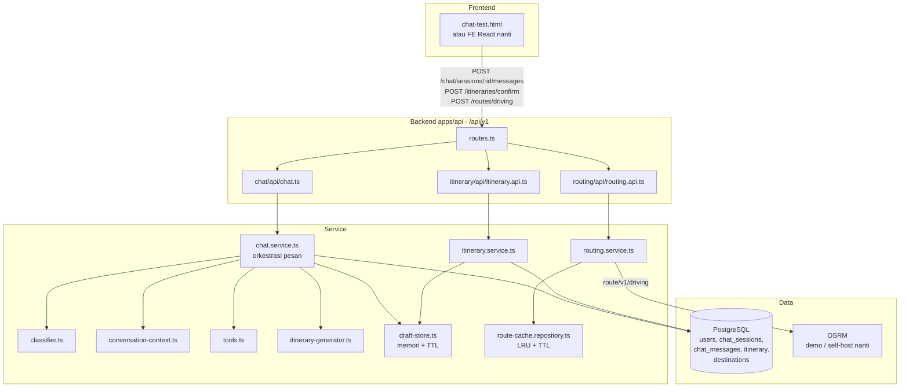
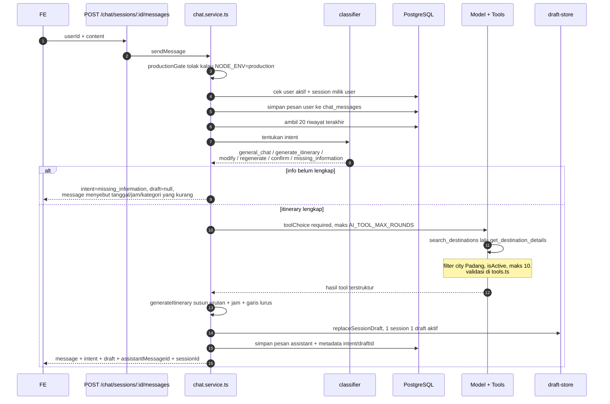
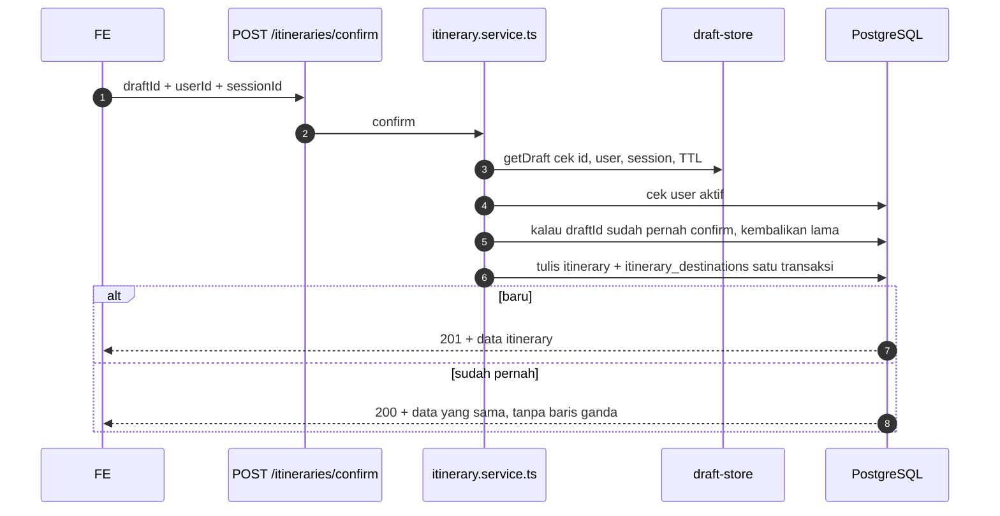
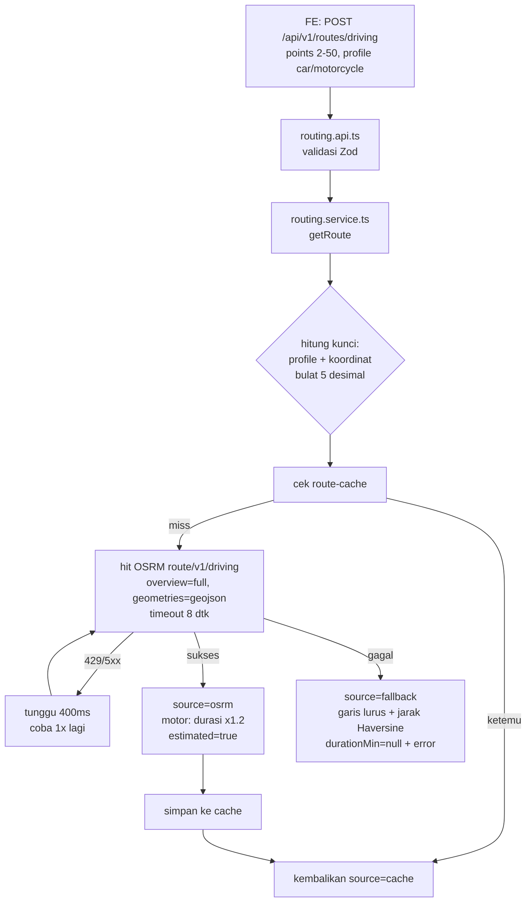
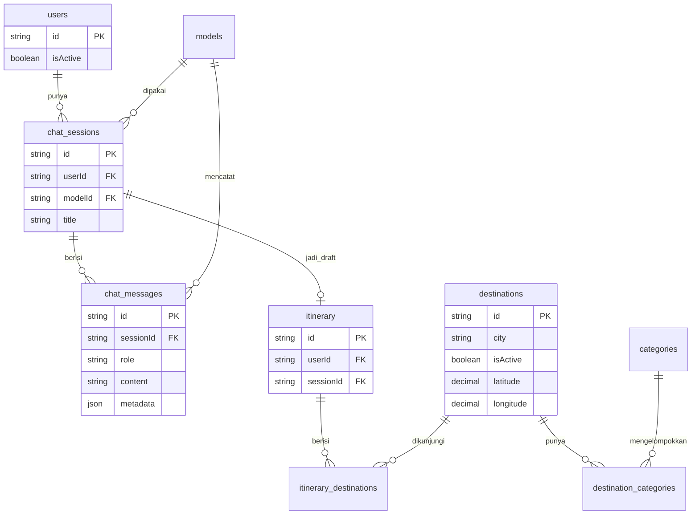

# Arsitektur Chatbot

Diagram di bawah menggambarkan kode yang sudah jalan sekarang. Bahasa Indonesia, nama modul dan endpoint sesuai kode.

Sumber utama: `docs/chatbot-routing-map.md` untuk alur lengkap dan `docs/chat-api-untuk-fe.md` untuk pemakaian dari FE.

## 1. Gambaran besar sistem

Aturan lapisan tetap: `api -> service -> repository -> DB/integrasi`. Route tidak query Prisma langsung. Fitur tidak saling impor, kode lintas fitur di `src/shared/`.

## 2. Alur kirim pesan sampai draft

Bentuk `draft`: `draftId, travelDate, startTime, endTime, destinations[{order, destinationId, name, latitude, longitude, visitAt, durationMinutes}], route LineString [lon,lat] atau null`.

## 3. Alur confirm itinerary

Draft hanya di memori. Restart API mengosongkan draft. Hasil confirm tidak selengkap draft, jadi FE simpan draft untuk gambar marker peta.

## 4. Alur routing jalan + cache

Catatan koordinat: input `{latitude, longitude}`, output `geometry.coordinates` urutan `[longitude, latitude]`, langsung cocok untuk MapLibre.

## 5. Relasi data yang dipakai chatbot

Tidak ada tabel chat baru. Draft dan cache rute sengaja di memori, bukan di DB.
